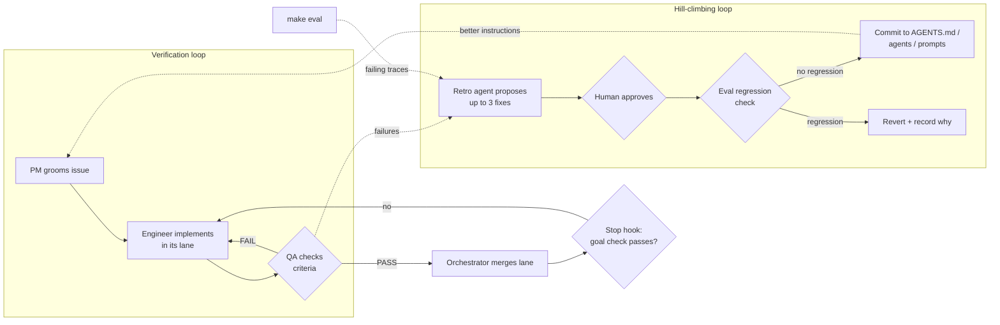

# Self-improving agent harness for Claude Code

[](https://github.com/rishikeshF/self-improving-agent-harness/actions/workflows/test.yml)
[](LICENSE)

A drop-in harness for building agentic systems with Claude Code: spec-driven issues, a team of subagents (PM, Architect, Engineer, QA, Eval, Retro), parallel engineers in git worktrees, and three nested loops. The agents work until checks pass, correct each other through QA, and propose fixes to their own instructions from what went wrong.

Built on two ideas:
- **AI-native development from specs**: a plan, a groomed backlog, and a PM -> Engineer -> QA graph where a QA FAIL loops back to the engineer.
- **Loop engineering**: an agent loop, wrapped in a verification loop, wrapped in a hill-climbing loop that improves the system over time.

Adapted for agentic systems: the state schema, graph and tool contracts are frozen before any parallel work, tests run against a fake LLM, and behaviour is measured with evals.

## The loops



| Loop | What runs it | Stops when |
|---|---|---|
| Agent loop | each subagent | its issue's "Done when" holds |
| Verification loop | QA subagent + Stop hook (`/goal`) | every criterion passes and the goal's check command exits 0 |
| Hill-climbing loop | Retro subagent (`/retro`) | proposals approved, and agent-behaviour changes show no eval regression |

## Quickstart

**Requirements:** [Claude Code](https://docs.claude.com/en/docs/claude-code), git, Python 3.11+, [uv](https://docs.astral.sh/uv/). On Windows, use WSL (see [RUNBOOK.md](RUNBOOK.md)).

**1. Install into a project** (new or existing; nothing is ever overwritten):
```bash
cd path/to/your-project
curl -fsSL https://raw.githubusercontent.com/rishikeshF/self-improving-agent-harness/main/install.sh | bash
```
Not building a Python agent? Add `-s -- . --no-skeleton` after `bash` to install only the process and subagents.

Prefer not to pipe to bash? Same result:
```bash
git clone https://github.com/rishikeshF/self-improving-agent-harness ~/.self-improving-agent-harness
python3 ~/.self-improving-agent-harness/scripts/install.py path/to/your-project
```
Starting from scratch? Click **Use this template** at the top of this page instead.

**2. Check it works:**
```bash
uv sync && make test        # all tests pass, no API key needed
```

**3. Describe what you want to build** in `_docs/plan.md` (one page), and write a few rough issues in `_docs/issues/` (copy `_docs/task-template.md`).

**4. Open Claude Code** (`claude`) and run the loop:
```
/groom                              groom all open issues in parallel (one PM subagent each)
"use the architect subagent on issue 01"   freeze contracts + runnable skeleton
/lanes tools:02 graph:03 evals:04   engineers in parallel worktrees, QA per lane, FAIL loops back
/backlog                            full orchestrator loop until every issue is closed
/goal tests green | make test | 6   block stopping until the check passes (max 6 tries)
/retro                              propose and apply self-improvements from recent failures
```

Easiest path: run `/backlog` and let the orchestrator drive. You approve merges and retro proposals; everything else loops on its own.

## FAQ
- **Does it overwrite my files?** No. Existing files are kept, `.claude/settings.json` is merged, `.gitignore` is appended to. The harness README lands as `HARNESS.md` so yours is untouched.
- **Do I need an API key?** Not for `make test` or `make eval-smoke` (they use a fake LLM). Only `make eval` calls a real model.
- **Not Python / not LangGraph?** Install with `--no-skeleton`, then edit the Commands section of `AGENTS.md` to your stack's test and lint commands. The subagents, loops and lanes work with any language.
- **Other coding agents?** `AGENTS.md` is read by Codex, Cursor and others too. The subagents, slash commands and Stop hook are Claude Code features.
- **How do I remove it?** Delete `AGENTS.md`, `CLAUDE.md`, `HARNESS.md`, `RUNBOOK.md`, `_docs/`, `scripts/`, and the `.claude/agents`, `.claude/commands`, `.claude/hooks` folders.

## What is inside

| Path | Purpose |
|---|---|
| `AGENTS.md`, `CLAUDE.md` | shared rules every agent loads, including strict code readability rules |
| `.claude/agents/` | pm, architect, engineer, qa, eval-engineer, retro |
| `.claude/commands/` | `/groom`, `/lanes`, `/backlog`, `/goal`, `/retro` |
| `.claude/hooks/goal_check.py` | Stop hook: the verification loop |
| `_docs/process.md` | roles, lifecycle, lane rules, loops |
| `_docs/agentic/` | state, graph, tools and evals contracts |
| `_docs/issues/`, `_docs/qa/`, `_docs/retros/` | local issue tracker, QA reports, self-improvement history |
| `scripts/` | worktree lanes, merge, goal, evidence collector, eval regression check, installer |
| `src/app/`, `tests/`, `evals/`, `prompts/` | LangGraph skeleton: planner -> act -> finish, FakeLLM, JSONL traces, eval runner |
| `RUNBOOK.md` | how to run a timed 4-hour build with this harness (Windows/WSL setup included) |

## How parallel agents work
One root Claude Code session orchestrates. It launches subagents several at a time:
- PM and QA subagents run in parallel freely; each writes only its own file.
- Engineer subagents each work in their own worktree (`.worktrees/<lane>`, branch `lane/<lane>`) and own a disjoint set of files.
- Issue 01 (contracts and skeleton) always runs alone first. Shared contracts first, then parallel work, so lanes never collide.
- The orchestrator merges one lane at a time after QA PASS and runs the tests after each merge.

## How self-improvement works
1. `scripts/collect_retro_evidence.py` gathers QA failures, the agent log, failing eval cases with their traces, past `process:` fixes and earlier retros into one digest.
2. The `retro` subagent finds failure modes that repeat (or that broke something important), traces each to where the fix belongs (a rule in `AGENTS.md`, a subagent file, a prompt, a tool description, the process), and writes at most 3 exact edits to `_docs/retros/`.
3. A human approves each edit. Changes to the built agent's behaviour are kept only if `scripts/compare_eval_runs.py` shows no tag pass rate dropped and no case flipped from pass to fail.
4. Every proposal keeps its outcome, including rejections, so `_docs/retros/` is a readable history of how the system got better.

The retro agent can never edit the files it proposes to change, and is forbidden from weakening tests, QA rules, evals or the goal check.

## Tests
```bash
make test        # graph tests (fake LLM) + tests for the retro helpers
make eval-smoke  # eval pipeline with the fake LLM
make eval        # real model, needs ANTHROPIC_API_KEY and `uv sync --extra llm`
```

## References
- AI-native development: specifications, backlog grooming and the PM / Engineer / QA graph (aishippingblog.com)
- Loop Engineering with LangChain Deep Agents (DeepLearning.AI): agent, verification, event-driven and hill-climbing loops

## License
MIT
